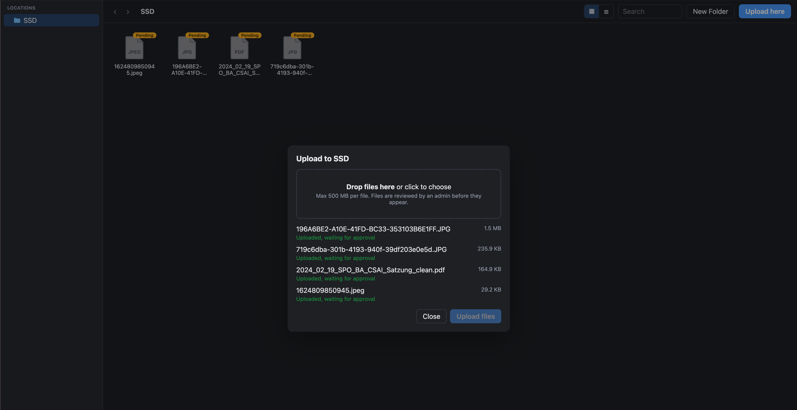
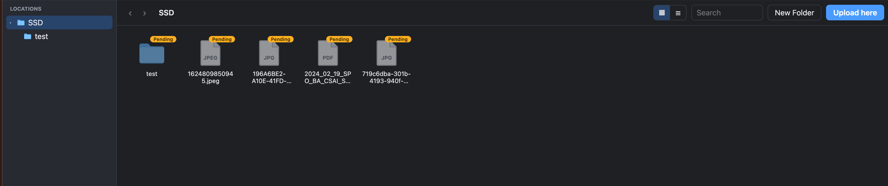
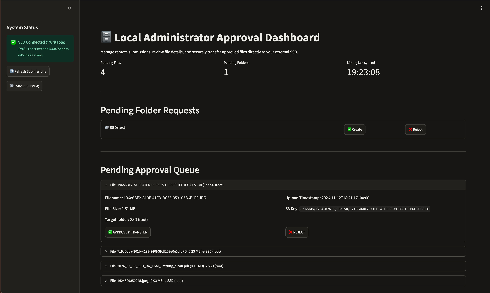

# Remote SSD Archive

Remote SSD Archive is a website for sending files from anywhere to an archive stored on a personally managed SSD. Users can browse the published folder structure, request folders, and upload files remotely through the site. Uploads are staged temporarily in an AWS S3 review queue; an administrator approves or rejects each submission. Approved files are then automatically transferred from S3 to the SSD, keeping the archive under local control while allowing remote contributions.

## Screenshots

The screenshots shared for this project show the main user flows:

- **Upload dialog:** selecting and uploading multiple files, with per-file progress and a waiting-for-approval status.


- **Archive browser:** browsing the SSD listing and seeing pending files and folder requests.



- **Administrator dashboard:** checking SSD status, creating or rejecting folder requests, and approving or rejecting queued files.



After clicking "approve" it extracts the file from Amazon S3 and loads it onto the SSD and then deletes the file in S3. If "rejected" is clicked, the file in S3 just gets deleted.

## How it works

```text
Browser (React)
  ├─ reads tree / requests folders / asks for upload URL ──> API Gateway + Lambda
  └─ uploads file bytes directly with a signed PUT ─────────> S3 queue

Local admin (Streamlit) <── lists and manages queue ─────────> S3
  └─ approves: downloads, verifies, then removes queued copy ─> mounted SSD
```

The admin dashboard publishes a JSON snapshot of the SSD directory at `published/tree.json`. The browser displays that snapshot and overlays pending folder requests and uploads. It does not read the SSD directly. A folder request is stored under `pending-folders/`; an upload is stored under `uploads/`. Neither appears on the SSD until the administrator approves it. Approval creates the requested destination directory if needed, downloads the file, checks that the downloaded size matches S3, then deletes the queued S3 object. If verification fails, the S3 copy is retained.

## Project layout

```text
.
├── admin-app/
│   ├── app.py                 # Streamlit admin dashboard and SSD sync/transfer logic
│   ├── config.json            # Bucket, AWS region, and local SSD destination
│   └── requirements.txt       # Python dependencies (see filename note below)
├── aws-backend/
│   ├── lambda_function.py     # API actions: tree, folder request, presigned upload
│   └── requirements.txt       # Lambda dependency list
├── frontend/
│   ├── src/                   # React UI and API client
│   ├── public/
│   └── package.json
└── README.md
```

The admin dependency file currently has the historical filename `requirments.txt`. The commands below use that existing name. 

## Requirements

- Python 3.9+ and pip for the local admin dashboard.
- Node.js and npm for frontend development/builds.
- An AWS account with an S3 bucket, Lambda, and API Gateway configured.
- AWS credentials available to the local admin process through the AWS CLI profile, environment, or another standard boto3 credential provider. Do not put access keys in the repository.
- The external SSD mounted and writable on the machine running the admin dashboard.

## Configuration

### Admin dashboard

Edit `admin-app/config.json` for your environment:

```json
{
  "aws_bucket_name": "your-s3-bucket-name",
  "aws_region": "eu-north-1",
  "ssd_destination_dir": "/Volumes/YourSSD/ApprovedSubmissions"
}
```

`aws_region` must be the region where the bucket lives. The checked-in sample config currently says `us-east-1`, while the Lambda defaults and existing API host use `eu-north-1`; set the correct region consistently for your deployment. The destination directory is created when possible and must be writable by the user running Streamlit.

Provide AWS credentials without embedding them in source files. For example, configure a named AWS CLI profile and set `AWS_PROFILE`, or use environment/instance credentials. The admin needs permission to list objects under `uploads/` and `pending-folders/`, read and delete queued objects, write `published/tree.json`, and download approved uploads. Scope IAM permissions to the bucket and required object prefixes.

### Lambda and API Gateway

The function reads these environment variables:

| Variable | Purpose | Default in code |
|---|---|---|
| `BUCKET_NAME` | S3 queue and published listing bucket | Project-specific bucket name |
| `BUCKET_REGION` | S3 bucket region | `eu-north-1` |
| `ALLOWED_ORIGIN` | Browser origin allowed by Lambda CORS | `*` |

Set `BUCKET_NAME` and `BUCKET_REGION` explicitly in Lambda. For a deployed site, set `ALLOWED_ORIGIN` to its origin instead of `*`. Configure API Gateway to invoke `lambda_handler`, accept `POST` and `OPTIONS`, and return/integrate the Lambda responses. The frontend's API URL is currently a constant in `frontend/src/api.js`; replace it with your deployed API URL, including the correct stage and route.

The Lambda role needs S3 permissions to read `published/tree.json`, list the `pending-folders/` and `uploads/` prefixes, create folder request objects, and generate presigned `PutObject` URLs for the upload prefix. The browser uploads directly to S3, so configure the bucket's S3 CORS rules to allow `PUT` from the frontend origin and allow the `Content-Type` header. Restrict CORS origins for production.

### S3 object layout

- `published/tree.json` — latest SSD listing snapshot.
- `pending-folders/<path-token>.json` — folder requests awaiting a decision.
- `uploads/<unique-id>/<path-token>/<filename>` — uploaded file awaiting review.

Folder paths are encoded as URL-safe base64 tokens. `~` represents the SSD root. The API validates path segments and names; it rejects separators, control characters, dot-prefixed names, and excessive path depth. The Lambda caps individual uploads at 500 MiB and the browser enforces the same limit.

## Run locally

### 1. Start the admin dashboard

From the project directory:

```bash
cd admin-app
python -m venv .venv
source .venv/bin/activate       # Windows: .venv\Scripts\activate
python -m pip install -r requirments.txt
export AWS_PROFILE=your-profile  # omit if credentials are supplied another way
streamlit run app.py
```

Open the local URL printed by Streamlit. Confirm the sidebar reports the SSD as connected and writable. Use **Sync SSD listing** after connecting the drive or whenever you want to publish a fresh snapshot. The app attempts an initial sync in a session when the destination is writable.

### 2. Start the frontend

In another terminal:

```bash
cd frontend
npm install
npm start
```

The development server prints its local URL. The browser must be able to reach your deployed API and the S3 bucket's presigned upload URL. `npm run build` creates an optimized static site in `frontend/build/` for deployment to a static hosting provider.

### 3. Deploy the Lambda API

Package `aws-backend/lambda_function.py` with its dependencies for the Lambda runtime, configure the environment variables and execution role above, and deploy it behind API Gateway. The checked-in `lambda_function.py.zip` is a prebuilt artifact; rebuild it from the current source and target runtime when making deployment changes. After deployment, update `API_ENDPOINT` in `frontend/src/api.js` to the API's invoke URL plus its route. Ensure API Gateway and S3 CORS are configured for the frontend origin.

## Using the system

1. The admin connects the SSD and publishes its listing.
2. Visitors browse folders using the tree, breadcrumbs, back/forward buttons, grid/list toggle, and current-folder search.
3. A visitor can request a folder or upload one or more files into the selected folder. Folder requests and file uploads wait in S3 for admin review.
4. The admin refreshes the queue. Folder requests can be created on the SSD or rejected. Files can be approved and transferred or rejected.
5. An approved file is saved into its requested folder. If a filename already exists, the dashboard chooses a numbered filename such as `report (1).pdf`. It compares the downloaded size with the S3 object size before deleting the queued object and refreshes the published listing after a successful transfer.

## API actions

The Lambda accepts JSON `POST` bodies with an `action` field:

| Action | Example body | Result |
|---|---|---|
| `tree` | `{"action":"tree"}` | Published tree plus pending folder and upload metadata |
| `createFolder` | `{"action":"createFolder","path":["Photos","2026"]}` | Creates a pending folder request |
| `presign` | `{"action":"presign","path":["Photos"],"fileName":"image.jpg","fileType":"image/jpeg","fileSize":1234}` | Returns a short-lived S3 PUT URL |

Legacy aliases `list_directory`, `create_folder`, and `upload_url` are also accepted. The API returns CORS headers and responds to `OPTIONS` preflight requests.

## Operational notes and limitations

- The published tree is a snapshot. It changes only when the admin syncs it, and the dashboard caps the listing at 20,000 nodes; a truncated flag is shown in the web UI.
- The browser overlays folder requests from S3 and files uploaded in the current browser session. The API returns pending upload metadata, but the current frontend does not hydrate its file overlay from that response, so pending files appear in the admin queue rather than reliably in the browser after a reload.
- File approval currently verifies existence and exact byte size, and computes SHA-256 for display. The checksum is not compared with a separately recorded expected checksum.
- The dashboard is intended to run locally where the SSD is mounted. Running it on a remote server will transfer files to that server's filesystem, not to a user's workstation.
- Admin actions are protected by access to the local Streamlit process and AWS credentials. Put the dashboard behind appropriate network access controls if it is exposed beyond the trusted machine/network.
- The Lambda currently allows all origins by default and has a project-specific bucket default. Set explicit production values and review the IAM role and bucket policy before deployment.
- Avoid committing `node_modules`, virtual environments, private credentials, or generated deployment artifacts unless your release process intentionally tracks them.

## Troubleshooting

- **SSD is not writable:** check that it is mounted at `ssd_destination_dir`, permissions allow the current user to write, and the filesystem is not read-only.
- **Admin cannot reach S3:** verify the AWS profile/role, bucket name, region, and IAM permissions. Check that the configured admin region matches the bucket region.
- **Tree does not update:** click **Sync SSD listing** and check the dashboard for a publishing error. Confirm `published/tree.json` can be written by the admin role.
- **Browser API errors:** verify the API URL in `frontend/src/api.js`, API Gateway deployment/stage, Lambda logs, and allowed origin/preflight behavior.
- **Upload PUT fails:** verify that the presigned URL has not expired (it is valid for five minutes), that the `Content-Type` matches the value used when requesting it, and that S3 CORS allows the site origin and `PUT`.
- **Transfer fails:** check SSD capacity, destination permissions, connectivity to S3, and the admin dashboard error. Failed size verification keeps the queued S3 object.
